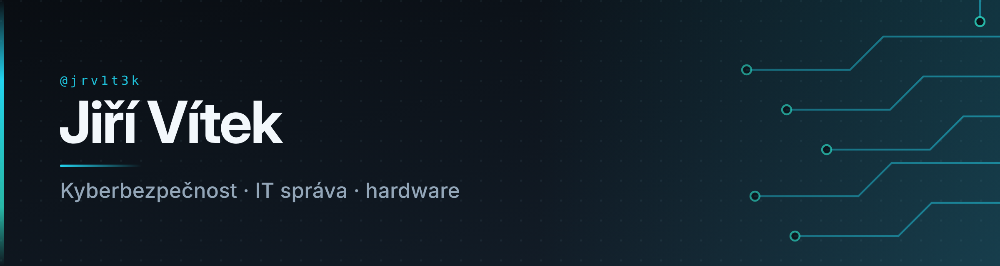
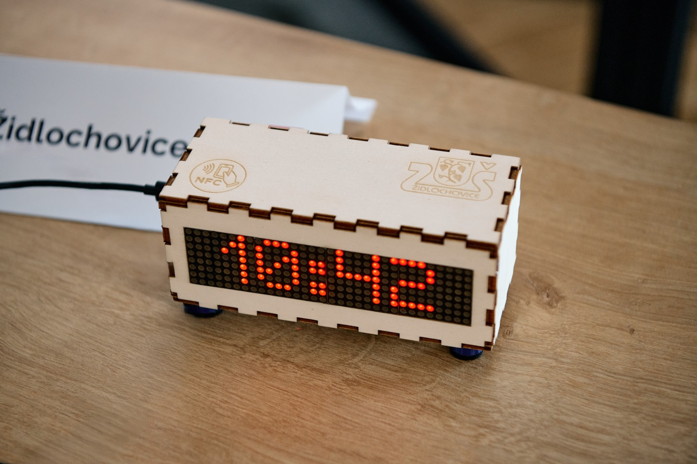

  

Ahoj! Jsem Jirka - a všichni mi říkají Vítku. 😄

Zajímá mě digitální odolnost - a to z obou stran. Pracuju jako specialista IT a kybernetické bezpečnosti: navrhuju a stavím počítačové sítě, nasazuju firewally a segmentaci a držím v chodu infrastrukturu klientů. Zároveň studuju kybernetickou bezpečnost na SŠVOŠIF Brno. V CTRL Europe, neziskovce, která buduje digitální odolnost pro novou evropskou generaci, vedu sociální sítě. Ve volném čase 3D tisknu a stavím vlastní hardwarové i softwarové projekty.

---

### 💼 Aktuálně

**Specialista IT a kybernetické bezpečnosti** - IKT Brno, 2024 - nyní

- **Počítačové sítě** - návrh a realizace: kabeláž, hardware i software.
- **Kybernetická bezpečnost** - návrh a implementace: firewally, segmentace, zálohování, správa přístupů.
- **Provoz IT** - správa infrastruktury, aktualizace, řešení incidentů, podpora klientů.

**Social media manager** - [CTRL Europe](https://ctrleurope.com), od 2026 
Člen neziskovky budující digitální odolnost pro novou evropskou generaci. Mám na starosti sociální sítě a kameru. 

**Opravy hardwaru** - koníček, 2023 - nyní 
Telefony, tablety a notebooky. Diagnostika i samotná oprava.

---

### 🔨 Na čem jsem pracoval

**[Chytrý budIQ - budík, který nejde vypnout tlačítkem](https://github.com/jrv1t3k/fablabsouzez_budik_s_unikatnim_vypinanim)**

Budík zmlkne až po správné odpovědi na otázku - matematickou nebo znalostní - takže ho nelze odklepnout v polospánku a usnout znovu.

Běží na **ESP32-S3 Pico** s vlastní navrženou deskou, 8×32 LED displejem a NFC. Webová aplikace pro správu budíků a otázek běží lokálně na zařízení, takže není potřeba žádná aplikace v telefonu. Krabička je 3D tištěná a gravírovaná.

Projekt vznikl pro soutěž na jaře 2025 s týmem ze ZŠ Židlochovice, kde jsem působil jako mentor, pod záštitou FabLabu Brno.

 

---

### 🧰 Nástroje & dovednosti

**Správa a infrastruktura**

**Virtualizace, sítě & bezpečnost**

**Hardware, servis & podpora**

**Vývoj, web & media**

---

### 🎓 Aktuální certifikáty

**IT Master Test 2026 - pro pokročilé** · 91,67 % (11 z 12 úloh) 
Pokročilá verze testu digitálních dovedností s komplexními a algoritmickými úlohami, přístupná jen po zvládnutí základní varianty. Organizuje Asociace pro aplikovaný výzkum v IT pod záštitou MŠMT.

---

### 📫 Kde mě najdeš

